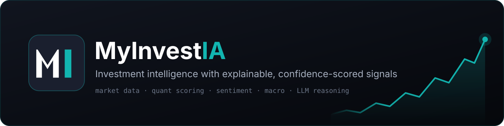
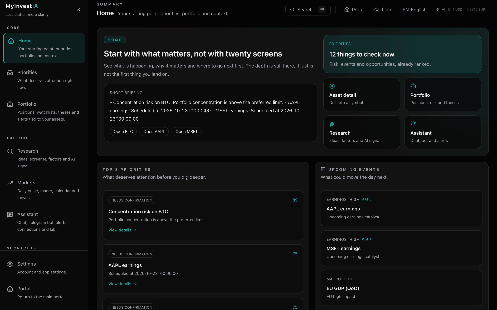
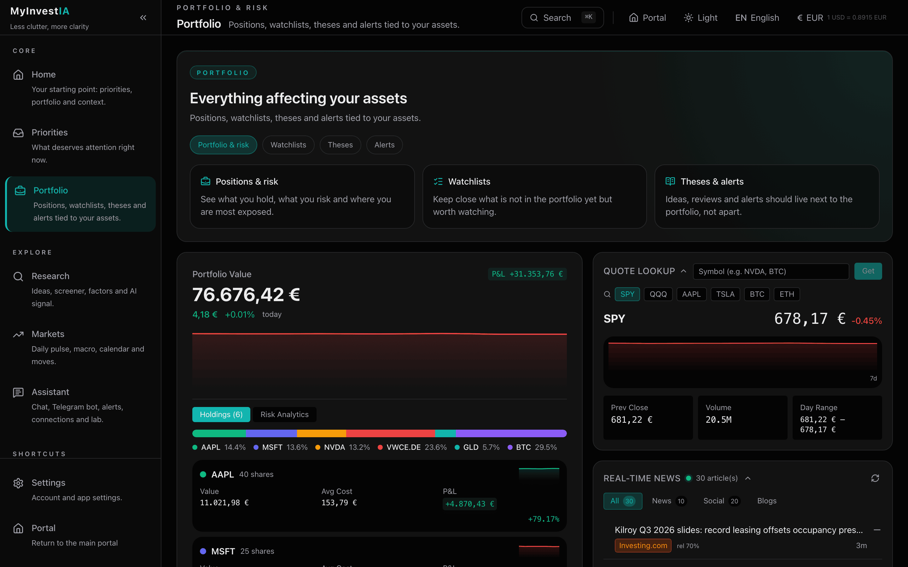
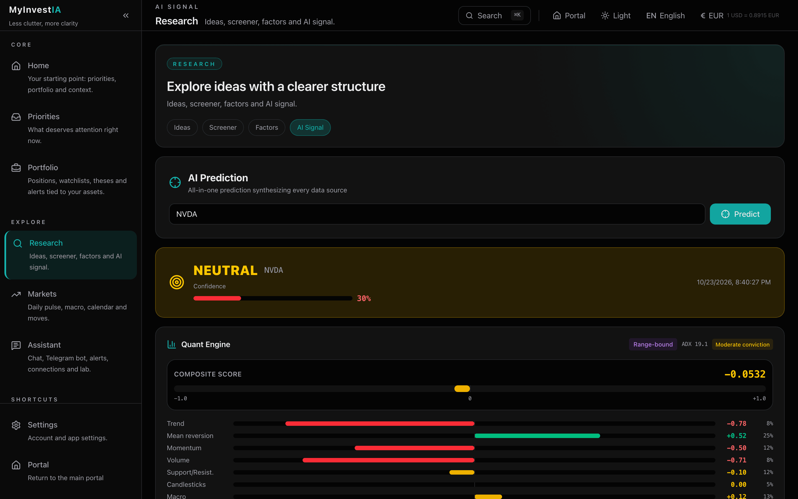
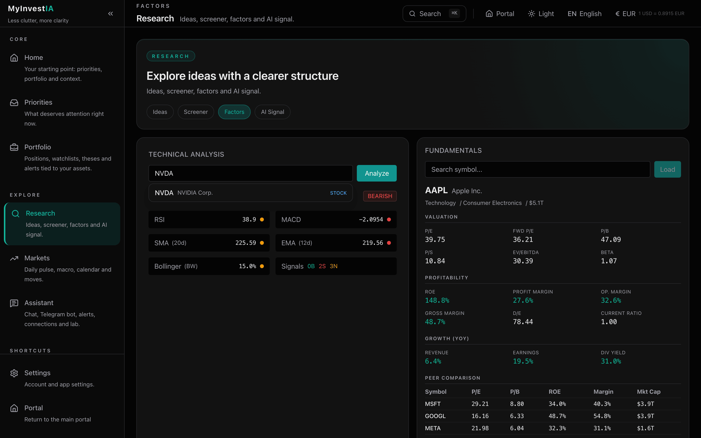
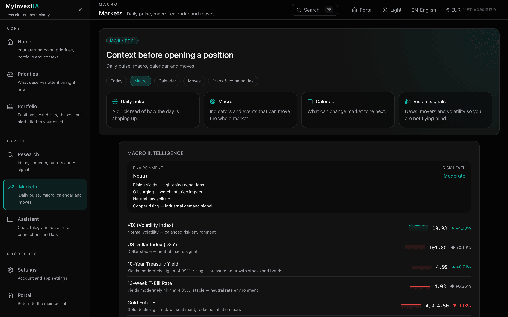
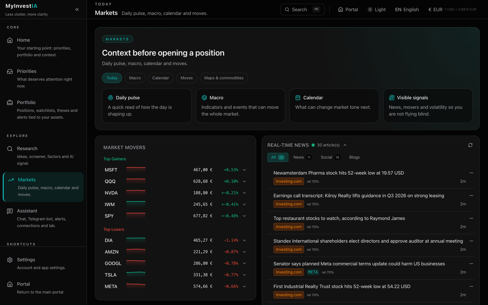
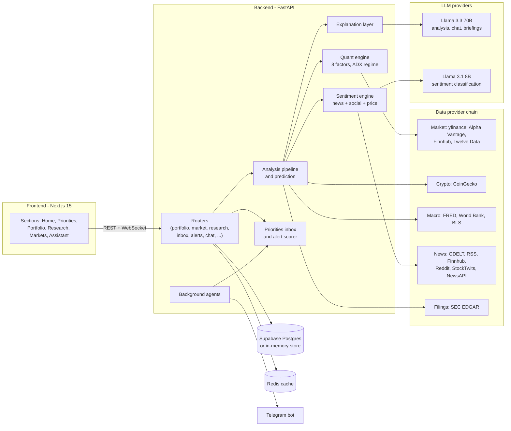

<p align="center">
  
</p>

<p align="center">
  
  
  
  
  
  
  
  
  
</p>

<p align="center"><b>A personal investment cockpit that turns market data, news and macro context into ranked, explainable signals instead of twenty dashboards.</b></p>

MyInvestIA aggregates prices, fundamentals, filings, news, social sentiment and macro indicators from a chain of free and paid providers, scores every asset with a regime-aware quantitative engine, and uses LLMs only where language helps: classifying sentiment, writing briefings and explaining why a signal fired. Every output carries a confidence score and the data points behind it.



## Screenshots

<table>
  <tr>
    <td width="50%"><br><sub><b>Portfolio and risk</b>: live valuation, allocation, per-position P&amp;L and a relevance-scored news feed.</sub></td>
    <td width="50%"><br><sub><b>AI signal</b>: one verdict per symbol with confidence, backed by the eight-factor quant engine.</sub></td>
  </tr>
  <tr>
    <td width="50%"><br><sub><b>Factors</b>: RSI, MACD, moving averages and Bollinger width next to valuation, profitability and peers.</sub></td>
    <td width="50%"><br><sub><b>Macro intelligence</b>: VIX, DXY, yields and commodities summarised into an environment and risk level.</sub></td>
  </tr>
  <tr>
    <td width="50%"><br><sub><b>Markets today</b>: top movers with sparklines and the real-time news stream.</sub></td>
    <td width="50%">
      Screenshots are taken from a local instance with a demo portfolio and live market data (1440x900, dark theme). Prices are shown in EUR through the display-currency setting.
    </td>
  </tr>
</table>

## Architecture



A request for a signal goes through the analysis pipeline: quotes and history come from the market chain, the quant engine computes eight factor scores, the sentiment engine merges news and social signals, macro context adjusts the risk level, and the explanation layer turns the result into text that cites the numbers it used.

## Key engineering decisions

- **Provider chains instead of a single data vendor.** Each data domain (market, crypto, macro, news, fundamentals, filings) has an ordered chain configured from the environment, for example `MARKET_PROVIDER_ORDER=yfinance,alphavantage,finnhub,twelvedata`. A provider that fails or is rate-limited is logged and skipped, and responses are normalised to one schema, so the app keeps working on free tiers and new sources are a single adapter.
- **Regime-aware quant scoring.** The quant engine scores trend, mean reversion, momentum, volume, support/resistance, candlesticks, macro and sentiment on a -1 to +1 scale. ADX (Wilder, 14 periods) decides whether the market is trending or range-bound, and each regime has its own weight set: trend factors dominate in trends, mean reversion in ranges. Factor agreement is reported separately as conviction.
- **LLMs where language matters, not for arithmetic.** Indicators, scores and risk metrics are deterministic Python. A small model (Llama 3.1 8B) classifies sentiment; a larger one (Llama 3.3 70B) writes briefings and explanations. If no LLM key is configured the scores still compute and the UI says the narrative is unavailable instead of failing.
- **Explainability as a contract.** Signals, alerts and inbox items carry a confidence value, the contributing factors and their weights. The explanation layer is prompted to reference concrete values (indicator readings, sources, price levels) rather than generic commentary.
- **A priorities inbox over raw alerts.** Risk alerts, earnings, macro events and research ideas are merged into one ranked list with priority, reliability and time horizon, so the home screen answers "what should I look at now" first.
- **Runs without infrastructure.** When Supabase is not configured the store falls back to an in-memory implementation, and Redis is optional. The whole stack can be started locally with two processes.
- **Tested core.** 309 deterministic backend tests cover scoring, providers, sentiment, alerts, portfolio and the RL agent. CI builds the backend image, runs the tests, builds the frontend and validates the Caddy and Compose configuration on GitHub-hosted runners.

## Quickstart

### Local development

Requirements: Python 3.11+, Node.js 22.

```bash
git clone https://github.com/diegoperezg7/MyInvestIA.git
cd MyInvestIA

# Backend
cd backend
python -m venv .venv && source .venv/bin/activate
pip install -r requirements.txt
cp .env.example .env            # set AIDENTITY_SECRET; LLM and provider keys are optional
uvicorn app.main:app --reload --port 8000

# Frontend (second terminal)
cd frontend
npm ci
npm run dev                     # http://localhost:3000, /api is proxied to :8000
```

The API expects a signed JWT (cookie `darc3_token` or `Authorization: Bearer`). For local use, sign one with the same `AIDENTITY_SECRET`:

```bash
python -c "import jwt,time; print(jwt.encode({'sub':'00000000-0000-0000-0000-000000000001','email':'demo@example.com','role':'admin','type':'access','exp':int(time.time())+86400}, 'YOUR_AIDENTITY_SECRET', algorithm='HS256'))"
```

Without `SUPABASE_URL` the backend uses the in-memory store, so data resets on restart.

### Docker

```bash
cp backend/.env.example backend/.env
docker compose up -d --build    # backend, frontend, Redis and Caddy on 127.0.0.1:8080
```

The Compose file expects two external Docker networks (`edge-myinvestia` and `supabase_default`) used by the self-hosted deployment. Create them with `docker network create` or remove them for a standalone run.

### Tests

```bash
cd backend && python -m pytest tests -q --ignore=tests/test_auth.py
```

## Configuration

All settings live in `backend/.env` (see `backend/.env.example`).

| Area | Variables | Required |
|---|---|---|
| Auth | `AIDENTITY_SECRET` | Yes |
| LLM | `CEREBRAS_API_KEY`, `GROQ_API_KEY` | No, narratives are disabled without them |
| Database | `SUPABASE_URL`, `SUPABASE_KEY` | No, falls back to in-memory |
| Market data | `ALPHAVANTAGE_API_KEY`, `FINNHUB_API_KEY`, `TWELVEDATA_API_KEY` | No, yfinance works without keys |
| Macro and filings | `FRED_API_KEY`, `BLS_API_KEY`, `SEC_USER_AGENT` | No |
| News and social | `NEWSAPI_KEY`, `REDDIT_CLIENT_ID`, `REDDIT_CLIENT_SECRET` | No |
| Provider order | `MARKET_PROVIDER_ORDER`, `NEWS_PROVIDER_ORDER`, ... | No, sensible defaults |
| Scoring | `SCORE_WEIGHT_*`, `SENTIMENT_DECAY_HALF_LIFE_HOURS` | No |
| Cache | `REDIS_URL` | No |
| Notifications | `TELEGRAM_BOT_TOKEN`, `TELEGRAM_CHAT_ID` | No |

Interactive API documentation is served at `/docs` when the backend is running.

## Repository structure

```
MyInvestIA/
├── backend/
│   ├── app/
│   │   ├── main.py              # FastAPI app and router registration
│   │   ├── config.py            # pydantic-settings configuration
│   │   ├── dependencies.py      # JWT auth and tenant resolution
│   │   ├── routers/             # 24 route modules (portfolio, market, research, inbox, ...)
│   │   ├── services/            # scoring, sentiment, macro, alerts, LLM clients, stores
│   │   │   ├── data_providers/  # provider chains and normalisation
│   │   │   └── quantitative/    # factors, backtesting, risk manager
│   │   ├── agents/rl_agent/     # PPO trading agent and scheduler
│   │   └── schemas/             # Pydantic v2 models
│   ├── supabase/                # SQL migrations
│   └── tests/                   # pytest suite
├── frontend/
│   └── src/
│       ├── app/                 # Next.js app router
│       ├── components/          # views, dashboard panels, charts
│       ├── contexts/            # auth, theme, navigation shell
│       ├── hooks/               # data hooks
│       └── stores/              # Zustand (language, currency)
├── openclaw/                    # profile for the self-hosted Telegram agent
├── docs/                        # engine and architecture notes, screenshots
├── docker-compose.yml
└── Caddyfile
```

Deeper write-ups: [architecture](docs/ARCHITECTURE.md), [scoring engine](docs/SCORING_ENGINE.md), [sentiment engine](docs/SENTIMENT_ENGINE.md), [data providers](docs/DATA_PROVIDERS.md), [explanation layer](docs/AI_EXPLANATION_LAYER.md), [alerting](docs/ALERTING.md), [RL trading agent](docs/RL_TRADING_AGENT.md).

## Disclaimer

MyInvestIA is a research and decision-support project, not financial advice. Its scores, alerts and suggestions should not be the sole basis for investment decisions.

## License

Copyright (c) 2024-2026 Diego Pérez. All rights reserved.

Published for portfolio and evaluation purposes only. You may read the code to evaluate the author's work; copying, modifying, distributing or using it requires written permission. See [LICENSE](LICENSE).
